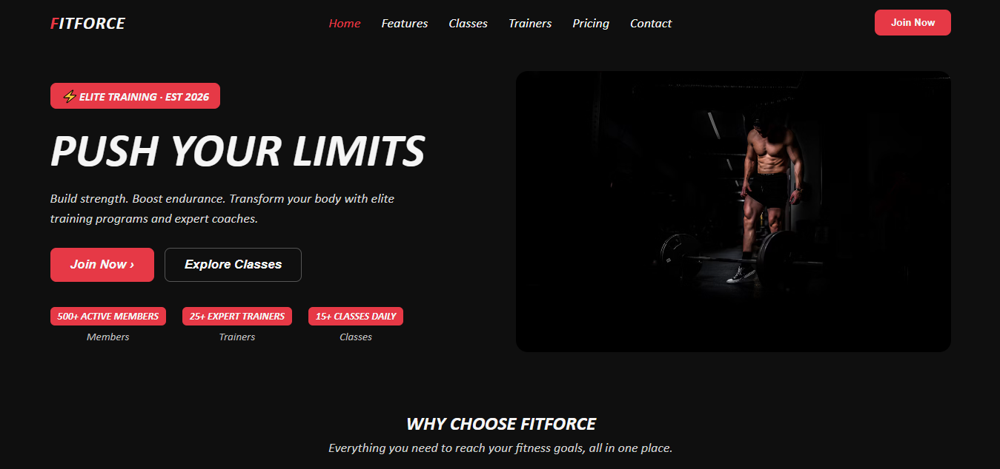
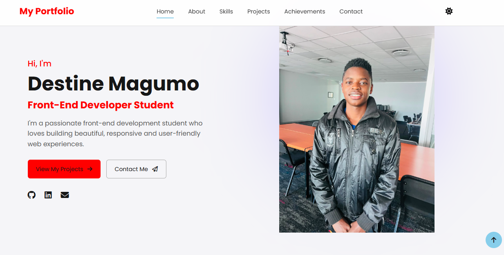
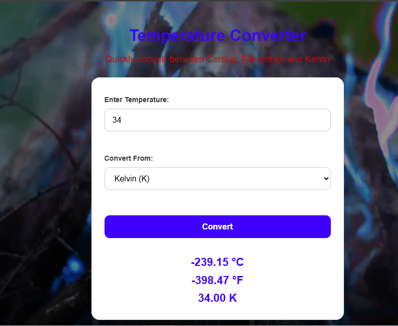

# OIBSIP - Web Development & Designing (Level 1)

Projects completed for the AICTE Oasis Infobyte Student Internship Program (SIP).

- **Track:** Web Development & Designing
- **Level:** Level 1 (all 3 tasks)
- **Intern:** Destine Magumo
- **GitHub:** [github.com/magumodestin](https://github.com/magumodestin)
- **LinkedIn:** [linkedin.com/in/destine-magumo-913571329](https://www.linkedin.com/in/destine-magumo-913571329/)

## Projects

| Task | Project | Folder | Task Repository | Tech | Live Demo |
| --- | --- | --- | --- | --- | --- |
| Task 1 | Landing Page (FITFORCE gym) | [WebDev-L1-LandingPage](./WebDev-L1-LandingPage) | [OIBSIP_webdevelopment_1](https://github.com/magumodestin/OIBSIP_webdevelopment_1) | HTML5, CSS3 | https://magumodestin.github.io/OIBSIP_webdevelopment_1/ |
| Task 2 | Personal Portfolio | [WebDev-L1-PersonalPortfolio](./WebDev-L1-PersonalPortfolio) | [OIBSIP_webdevelopment_2](https://github.com/magumodestin/OIBSIP_webdevelopment_2) | HTML5, CSS3, JavaScript | https://destineportfolio.vercel.app/ |
| Task 3 | Temperature Converter | [WebDev-L1-TemperatureConverter](./WebDev-L1-TemperatureConverter) | [OIBSIP_webdevelopment_3](https://github.com/magumodestin/OIBSIP_webdevelopment_3) | HTML5, CSS3, JavaScript | https://temperatureconverter-black.vercel.app/ |

Each folder and each task repository has its own `README.md` covering the objective, steps performed, tools used and outcome.

## Screenshots

### Task 1 - Landing Page (FITFORCE gym)

### Task 2 - Personal Portfolio

### Task 3 - Temperature Converter

## Notes

- The Personal Portfolio and Temperature Converter began as earlier personal projects. For this internship the Temperature Converter was updated with Kelvin support, an all-units result and an absolute zero check, and the portfolio received content and link fixes.
- The Landing Page was newly built for this internship.

## Contact

Email: magumodestiny@gmail.com
